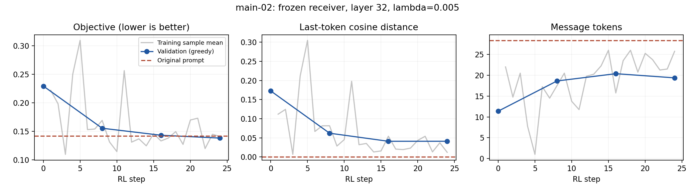
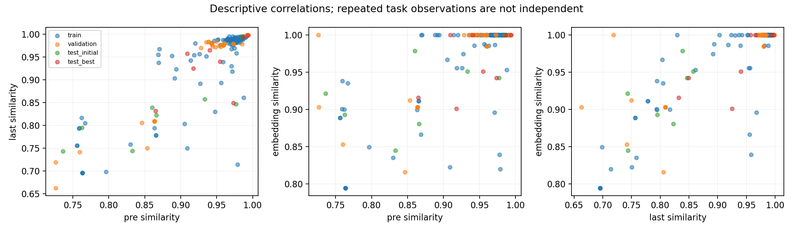

# 首轮实验结果：2026-11-23

**这套奖励可以驱动实际学习，并在小规模留出指令上改善末 token 表征保真。当前还没有发现人类不可理解的新语言。** 学出的消息主要是自然语言缩写、算式和代码；RL 的主要收益是减少表征距离，而不是让已经会压缩的初始发送者再变短。

## 独立测试结果

测试共 8 条指令，训练和验证均未使用这些指令。根据 8 条验证指令的组合损失选择第 24 步 checkpoint 后，才进行本轮测试。下面的“长度”仅计消息内容 token，双方共用的聊天模板不计入。

| 指标 | 完整原文 A | 未训练发送者 | RL 后发送者 |
|---|---:|---:|---:|
| 平均消息 token 数 | 31.875 | 19.625 | 19.875 |
| 末 token 表征余弦距离 | 0 | 0.169827 | 0.067279 |
| 生成前表征余弦距离 | 0 | 0.130810 | 0.057421 |
| 距离 + 0.005 × 消息长度 | 0.159375 | 0.267952 | 0.166654 |
| 与原文输出逐字相同的比例 | 1 | 0.125 | 0.5 |

相对未训练发送者，末状态距离降低约 60.4%，组合损失降低约 37.8%，长度增加 0.25 token。RL 后消息总计 159 token，原文总计 255 token，即减少约 37.6%；这项压缩能力并非全由 RL 获得，初始发送者已经能生成短消息。

**当前 lambda 下，测试组合损失仍略高于直接发送原文：0.16665 对 0.15938。** 验证集上则略低于原文：0.13797 对 0.141875。因此不能宣称已经稳定找到优于原文的整体最优编码。

逐字相同率不是任务正确率。这里保留的是模型在原指令下的表征；原模型本身也可能答错。

按这 8 个任务进行配对 bootstrap，RL 相对初始发送者的距离变化均值为 -0.10255，探索性 95% 区间约 [-0.16318, -0.04280]；长度变化区间约 [-7.5, 8.0]。样本少、仅一个主运行 seed，不将这些区间作为广泛泛化的证据。



## 全部测试样本

| ID | 原文 token | RL 消息 token | 末状态距离 | 输出情况 |
|---|---:|---:|---:|---|
| test-000 | 33 | 14 | 0.034672 | 两侧均输出 37 |
| test-001 | 43 | 26 | 0.059538 | 相同列表，空格格式不同 |
| test-002 | 28 | 24 | 0.002035 | 德语译文相同 |
| test-003 | 37 | 17 | 0.042628 | JSON 输出相同 |
| test-004 | 31 | 29 | 0.150601 | 字符串变换输出不同；原模型输出本身也有误 |
| test-005 | 25 | 16 | 0.074947 | 原文输出 200，压缩后输出 190 |
| test-006 | 30 | 11 | 0.168074 | 消息变成函数代码，接收者解释代码而非仅输出函数 |
| test-007 | 28 | 22 | 0.005740 | 两侧均输出 SAMPLE.NET |

几个实际生成的消息：

```text
test-000: (28+46)/2=? Output final num only.
test-001: Filter [6,11,2,11,8] >5, sort desc, keep dups → list.
test-005: 3h40m→min, -20m, output num only
test-006: def is_even(n): return n%2==0
```

所有样本均保留，包括结果不佳的样本。最后两例反映了这轮实验的实际限制：表达看似合理并不代表原模型的输出会被保持；发送者也仍会把“压缩指令”做成“给出答案”。本轮没有针对这些测试案例修改运行提示词或追加训练答案。

## 三种表征的相关性

独立 embedding 使用 multilingual-e5-small，固定模型版本 `614241f622f53c4eeff9890bdc4f31cfecc418b3`，只编码完整输出文本，不编码原始指令。attention-mask mean pooling 后归一化，双方均使用 `query: ` 前缀。无文本超过 embedding 上限，未丢弃输出内容。

| 相似度配对 | 全部观测 Pearson | 全部观测 Spearman | RL 后独立测试 Pearson |
|---|---:|---:|---:|
| 生成前状态 vs 末状态 | 0.8542 | 0.8005 | 0.5623 |
| 末状态 vs 输出 embedding | 0.8397 | 0.6802 | 0.7561 |
| 生成前状态 vs 输出 embedding | 0.7005 | 0.5127 | 0.5194 |

全部观测为 144 条、40 个不同任务，不包括恒等输入的 sanity check；相同任务在候选或 checkpoint 间重复出现，不能当作 144 个独立样本。RL 后独立测试只有 8 条。这些结果支持继续研究末状态作为优化信号，但没有证明某种表征普遍更好，也没有人工语义等价评分。



## 实现与工程验收

- 使用现有 27B NF4 模型；真实 architecture 为 Qwen3_5ForConditionalGeneration，64 层，取第 32 层输出。RTX 6000 Ada 48GB 上主实验峰值约 17.42GiB，无需删除或更换模型。
- 发送者 rank-8 LoRA，q_proj/v_proj，共 3,014,656 个可训练参数。接收者关闭 adapter，底座不更新。
- 奖励严格是负的表征余弦距离与 token 长度成本之和。实现为 REINFORCE + leave-one-out baseline，每条指令独立采样 4 个候选；没有附加 embedding、正确率或 KL 奖励。
- 主运行 24 步、24 条训练指令、8 条验证、8 条测试。学习率 1e-4，lambda=0.005，采样温度 0.85。主运行约 902 秒，前面的试跑和失败轮次另计。
- 所有普通词表 token 均可参与消息，聊天/多模态控制 token 不作为消息内容；直接传 token ID，不经过文本重新分词。
- 生成结束后完整重放序列，明确取处理完最后内容 token 后的状态；EOS/im_end 不作为内容末 token。同时保存 prompt 末位置的生成前状态。
- 仅输入 prompt 的独立前向检查与保存的前状态距离为 0；训练结束后冻结接收者的参考状态逐元素最大误差为 0，文本不变。
- 远端 7 项自动测试通过。主运行 145 条观测全部通过离线重算：状态索引、消息 ID、前/末距离和奖励一致。3 个 checkpoint 的 64 个 LoRA 张量均实际更新。
- 实际采样与 teacher-forced 训练 likelihood 核查中，一个 3-action 样本的逐 token log probability 最大差异约 0.0000316；数值差异被记录，未声称所有长度上逐比特一致。
- 截断失败没有被忽略：旧的 192-token 上限导致 main-01 在中文蒸发任务停止；提高到 1024 后，单独重放同一失败消息，前 192 token 完全一致，第 216 token 后正常结束。main-02 保留全部任务重跑。
- 训练和后处理进程均已退出，最后检查 GPU 使用 56MiB、利用率 0%。

## 文件位置

- 代码及方法：[readme.md](../readme.md)、[训练程序](../latent_protocol/train.py)、[相关性分析](../latent_protocol/analyze.py)。
- 完整决策与失败记录：[experiment_log.md](experiment_log.md)。
- 机器环境与模型元数据 hash：[environment.json](environment.json)。
- 主结果：[main-02-comparison.json](main-02-comparison.json)、[main-02-correlations.json](main-02-correlations.json)、[main-02-audit.json](main-02-audit.json)。
- 远端运行：`/workspace/latent-protocol/runs/main-02/`；最佳 adapter：其中的 `best/`。
- 本地原始观测、状态与最佳 adapter：`/home/Xenosymbol/runs/remote/runs/main-02/`；独立 embedding 在邻近的 `main-02-analysis/`。

当前完成的是第一版真实 RL 实验及验证闭环。更大规模任务、其他随机种子、lambda 的压缩—失真曲线，以及不可读符号是否能形成稳定协议，尚无本轮证据支持。后续改动必须使用新的最终测试集，不能继续用已揭盲的这 8 条测试做泛化验收。
