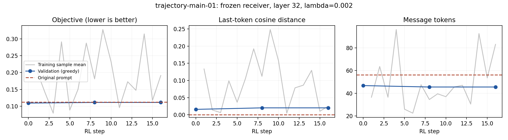
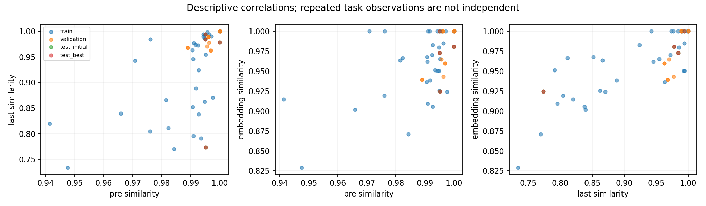

# 在完整轨迹中重写 user 消息

已经按新的方式跑完：发送者看到此前的完整历史和工具定义，重写中途的一条 user 消息；冻结接收者分别接收原消息与新消息，其余上下文完全相同。**这轮 16 步 RL 没有超过训练前的重写基线，不能称为学出了新语言。**

口径说明：原文是表征参照，不改写的距离为 0。下文“基线重写器”专指训练前的发送者；其生成消息的距离表示相对于原文的偏差，不是“改写带来的距离改善”。只有固定编码提示及其他配置，比较发送者训练前后，才能判断 RL 是否缩小了距离。

## 一个实际例子：赶航班的用户取消订单

来源是 [NVIDIA Nemotron-Agentic-v1 / interactive_agent](https://huggingface.co/datasets/nvidia/Nemotron-Agentic-v1)，属于公开的合成 agent 轨迹。下面是最终测试中的 `69d20d25-b3f5-44b2-919a-92aef98a69bb-turn-5`。为方便阅读只展示历史摘要；模型实际收到完整系统策略、全部历史消息和全部工具定义。

此前发生了这些事情：

1. 用户说自己在赶下午 2 点的航班，订单号是 ORD1048，想知道延误是否由天气造成。
2. agent 调用 get_order_status 查询 ORD1048。
3. 工具返回：订单仍在备餐，延误来自餐厅订单量，天气没有影响。
4. agent 告知情况，并问用户继续等待还是取消。

这时用户发来原消息（40 token）：

```text
Thank you for the update. Given the uncertainty and my tight flight schedule, I’d like to cancel the order and request a refund. Can you confirm the refund process and ensure it’s processed promptly?
```

意译：“谢谢更新。考虑到不确定性和紧张的航班时间，我想取消订单并退款。能否确认退款流程，并确保尽快处理？”

重写器实际生成（29 token）：

```text
I’d like to cancel order ORD1048 and get a refund. Please confirm the refund process and make sure it’s handled quickly.
```

新消息从历史中取出了订单号 ORD1048——当前这条原 user 消息本身没有订单号。两路接收者都生成了同一个工具调用，下面用便于阅读的形式表示：

```text
cancel_order(order_id="ORD1048", reason="user_request")
```

这条消息从 40 缩到 29 token，末状态距离约 0.00611。它说明当前实现确实使用了共享历史来重写消息。**这个例子来自验证选出的基线重写器，并非本轮 RL 的额外收益。** 工具调用只是模型生成的文本，没有实际取消任何订单。

还做了一个上下文替换检查：当前 user 消息完全不变，只把历史中 4 处 ORD1048 换成此前未使用的 CTX704219。重写结果也只将订单号换成 CTX704219，接收者随后生成 `cancel_order(order_id="CTX704219", reason="user_request")`。这提供了该例中利用历史信息的直接证据。这是测试揭盲后的诊断，不计入独立测试成功数，也没有用于更新模型或提示词。

## 本轮到底做了什么

- 来源版本：`650d590978ca35c8f1ecea2faf136e5fac421b62`，CC-BY-4.0，作者 NVIDIA Corporation。
- 从文件前 256 条中按结构筛出 79 条候选；选 24 条不同轨迹，16 条训练、4 条验证、4 条最终测试。
- 切点必须是非首条 user 消息，之前出现过工具返回，之后存在 assistant 消息。每条轨迹只取一个切点，优先靠近轨迹时间中点。
- 原始接收者输入约 3164–4037 token，当前 user 消息为 29–151 token。不截断历史；未来轨迹内容不进入输入。
- 去除工具调用随机 ID 后，跨组没有完全重复的“历史 + 工具 + 当前消息”。不同任务仍共享相同领域政策，不能据此宣称跨领域泛化。
- 沿用冻结 27B NF4 接收者及 rank-8 发送者 LoRA，取第 32 层；只优化末内容 token 状态余弦距离和当前消息长度。
- 正式运行 lambda=0.002，lr=1e-4，16 步，每步 2 个候选；第 8、16 步验证。发送者最多 96 token，接收者最多 1024 token。
- 比较的是该位置下一条 assistant 回复或工具调用，不是重新执行整条轨迹，也不把原数据未来的工具结果接到新的动作后面。

## 训练结果：没有额外收益

| 验证阶段 | 平均消息 token | 末状态距离 | 组合损失 |
|---|---:|---:|---:|
| 完整原文 | 56.25 | 0 | 0.112500 |
| 训练前 | 46.75 | 0.015817 | 0.109317 |
| 第 8 步 | 45.50 | 0.020203 | 0.111203 |
| 第 16 步 | 45.50 | 0.020203 | 0.111203 |

训练让消息略短，但距离增大，总损失没有超过训练前。因此按预定规则选择第 0 步作为 best。

4 条独立测试的当前最佳重写器平均使用 60 token，原文平均 72 token；末状态距离为 0.067512，组合损失为 0.187512，而原文组合损失为 0.144。整体尚未优于直接发送原文。

`test_initial` 与 `test_best` 的数字完全相同，是因为选中了同一个初始策略；这不是学习提升，也不是“完美稳定性”的统计证据。配对区间因此为零，不能当作泛化置信度。



## 全部独立测试情况

| 测试场景 | 原文 → 新消息 token | 距离 | 观察 |
|---|---:|---:|---|
| 舒芙蕾配送需避开颠簸路线、转人工 | 68 → 68 | 0.021892 | 没有缩短；同样转人工，issue_summary 文字不同 |
| 赶航班，取消 ORD1048 并退款 | 40 → 29 | 0.006107 | 函数名和全部参数完全相同 |
| 请求复杂几何餐饮安排的文档 | 102 → 96 | 0.226404 | 发送者达到 96-token 上限，消息未正常结束；后续行为改变，是明显失败例 |
| 帐篷位置、标识和配料确认 | 78 → 47 | 0.015646 | 两侧都确认配送，回复措辞和部分说明不同 |

第三条没有被移除，也没有把截断生成包装成有效压缩。这次所有接收者回复都正常结束，但发送者的消息上限仍暴露了失败情况。当前结果只支持“小样本上下文重写已实现”，不支持所有消息都保真或发现不可读协议。

## 长背景会不会让任意消息都显得相似

在同样的 4 条验证历史下，保留正确重写、把当前 user 消息留空、以及换成另一条无关 user 消息，结果如下：

| 条件 | 末状态距离 | 生成前状态距离 |
|---|---:|---:|
| 训练前发送者的重写 | 0.015817 | 0.002993 |
| 空消息 | 0.186085 | 0.110571 |
| 无关消息 | 0.185838 | 0.051761 |

在这些样本中，正确重写的状态明显更近。空消息和无关消息只作对照，没有加入 RL 奖励。

独立输出 embedding 仍使用固定的 multilingual-e5-small。排除负对照和恒等检查后，共 52 条观测、24 个不同任务：末状态相似度与输出 embedding 相似度的 Pearson 相关约 0.798，生成前状态约 0.535。没有 embedding 文本截断。任务存在重复观测，这些相关性仅作描述，不能当作大样本独立检验。



另记录函数名和参数的逐项一致性，不执行工具，也不把它称为任务正确率。自由文本 issue_summary 的改写会被这个严格对照判为不同，即使表达的意思相近。

## 验证和产物

- 15 项远端测试通过。
- 61 条观测的距离、奖励、输入替换边界和 context hash 通过审计；隐藏状态均为有限值；轨迹分组没有 ID 交叉。
- 冻结接收者重新前向，状态最大逐元素差为 0，输出不变；关键检查不使用缓存。
- 两个训练 checkpoint 的 64 个 LoRA 张量均发生更新，不能把“无验证收益”误解为没有真的训练。
- 峰值显存约 23.26GiB。正式轮次约 2441 秒，试跑另计。训练与后处理均结束，GPU 最后检查为 56MiB、0% 利用率。
- 本地数据与状态：`runs/remote/runs/trajectory-main-01/`；独立 embedding：相邻 `trajectory-main-01-analysis/`。
- 上下文替换诊断：`runs/remote/runs/trajectory-context-binding/`，包含干预输入、生成文本和状态。
- 远端：`/workspace/latent-protocol/runs/trajectory-main-01/`。`best/` 是初始策略；实际训练后的权重在 `checkpoint-0016/`，两者不能混称。

[数据与复现方式](../data/trajectories/README.md) · [实验决策记录](trajectory_experiment_log.md) · [完整指标](trajectory-main-01-comparison.json) · [审计](trajectory-main-01-audit.json)

最终测试已揭盲；后续若调整提示词、预算或训练方法，应使用新的最终测试轨迹。
